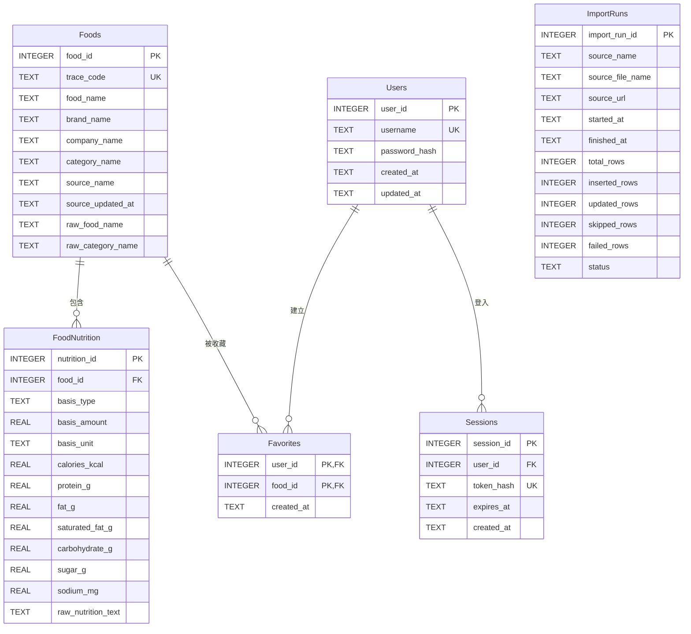

# FoodLens 資料庫 ERD

## 設計規則

- `Foods.trace_code`：官方資料的唯一識別碼，不可重複。
- `FoodNutrition`：同一食品可依「每份、每 100g、每 100mL」保存不同營養資料。
- 營養缺值一律保存為 `NULL`，不以 `0` 代替。
- 食品比較只允許相同 `basis_type` 的資料互相比較。
- `Favorites` 使用 `(user_id, food_id)` 複合主鍵，避免重複收藏。
- `Sessions` 僅保存 Token 雜湊值，不保存原始 Token。
- `ImportRuns` 記錄每次官方資料匯入結果，便於追查資料來源與失敗筆數。